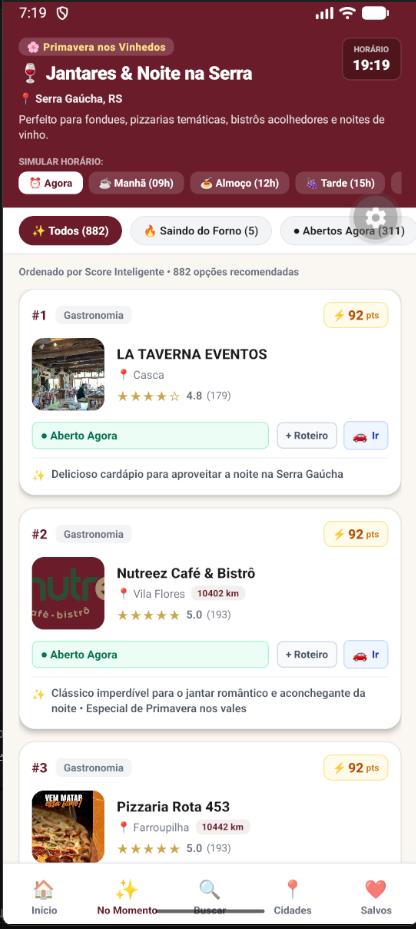
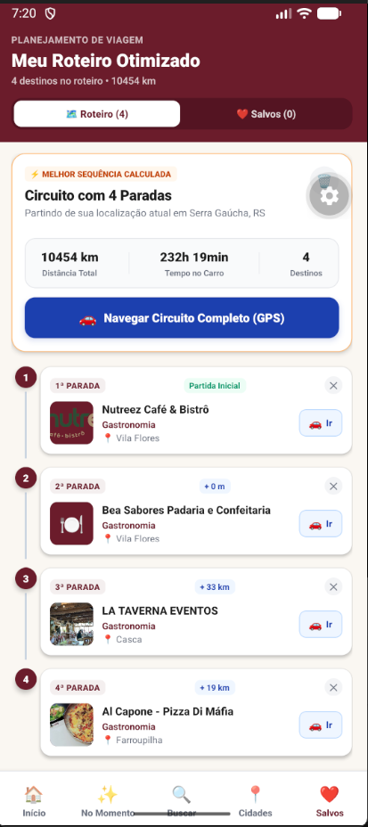

<div align="center">

# Tourism Mobile App

### Explore Veranópolis and Serra Gaúcha, Brazil

**A cross-platform tourism experience built with React Native, Expo, and TypeScript.**

Discover places, explore regional news, find nearby attractions, save favorites, and plan multi-stop itineraries—all from your phone.

[Features](#-features) · [Screenshots](#-screenshots) · [Tech Stack](#-tech-stack) · [Getting Started](#-getting-started) · [Limitations](#-known-limitations)

</div>

> **Project status:** Functional prototype / portfolio project. The app consumes tourism data from an **existing institutional platform** associated with Atuaserra and `serragaucha.com`; it does **not** implement or replace that platform's backend. “Tourism Mobile App” is the repository title, not an official app or partner brand.

## 🎯 Overview

Tourism information for Veranópolis and Serra Gaúcha is already available through a centralized website and institutional APIs. This project explores what a **mobile-first experience** can add to that foundation: location-aware discovery, contextual recommendations, saved places, and itinerary planning.

The goal is to make existing information easier to use while traveling—not to recreate the original content platform.

## ✨ Features

| Feature | What it does |
| --- | --- |
| **Explore & search** | Browse featured places, cities, categories, establishments, and regional news; filter results and sort by proximity. |
| **Place details** | View available details, operating hours, contact actions, sharing, and links to navigation apps. |
| **Location awareness** | Request device location with `expo-location`, identify a nearby municipality, or select a city manually. |
| **“No Momento” recommendations** | Rank venues using available reputation data, operating status, time of day, season, and proximity. |
| **Favorites** | Save places locally with AsyncStorage. |
| **Itinerary planning** | Organize selected places using a nearest-neighbor heuristic and estimated geographic distances. |
| **Maps & directions** | Send an itinerary to Google Maps or navigate to its first stop with Waze, subject to platform support. |
| **News** | Read regional articles and event-related content from institutional data sources. |
| **Offline-tolerant data access** | Reuse a 30-minute cache of previously retrieved institutional data when appropriate. |

### How recommendations work

The “No Momento” feature is a **rule-based ranking algorithm**, not a machine-learning or generative-AI model. Its configured score weights are:

- Reputation: **35%**
- Operating status: **35%**
- Context (time/season): **20%**
- Proximity: **10%**

Open or soon-to-open places are prioritized ahead of closed ones, followed by weighted scoring. A 60-minute upcoming-opening window is included in the contextual logic. Actual opening hours depend on data quality and may not reflect holiday exceptions.

### How itinerary optimization works

The app uses a **nearest-neighbor heuristic** to select the next unvisited destination closest to the current position. Distances are calculated geographically with the Haversine formula, and travel time is approximated using a reference speed of **45 km/h**.

This approach is fast, but **does not guarantee the globally shortest route**. Distances are not road-network distances, and estimates do not account for traffic or terrain.

## 📱 Screenshots

These screenshots are included in the repository and illustrate the existing prototype. They are **not** evidence of post-refactor device testing; some displayed values may be demonstrative.

| Home | No Momento | Optimized itinerary | News details |
|:---:|:---:|:---:|:---:|
|  |  |  |  |

## 🛠 Tech Stack

| Technology | Purpose |
| --- | --- |
| **React Native 0.86.3 / React 19.2.3** | Cross-platform UI |
| **Expo SDK 57** | Development workflow and device integrations |
| **TypeScript (strict mode)** | Static typing and safer contracts |
| **React Navigation 7** | Bottom tabs and stack navigation |
| **expo-location** | Device permissions, geolocation, and reverse geocoding |
| **AsyncStorage** | Persistent favorites, itineraries, and institutional cache |
| **Fetch API** | HTTP requests to the institutional API |
| **expo-web-browser / Linking** | External web pages and navigation apps |
| **Vitest / react-test-renderer** | Automated logic, mocked integration, and persistence tests |

The project has its own Haversine distance calculation, contextual recommender, and nearest-neighbor itinerary optimizer. These are **project implementations**, not third-party optimization libraries.

## 🗂 Project Structure

```text
App.tsx                  # App providers and navigation container
src/
  api/                   # HTTP client, data services, validation, reviews proxy
  components/
    cards/               # Places, cities, news, recommendations, itinerary
    common/              # Shared UI and review components
  constants/             # Theme, reference data, optional demo fixtures
  context/               # Location, favorites, itinerary state
  navigation/            # Tab and stack navigation
  screens/               # App screens
  types/                 # Data models and navigation contracts
  utils/                 # Geolocation, ranking, routes, deep links
tests/                   # Automated tests using mocks
docs/                    # Screenshots, security notes, refactor report
scripts/                 # Developer utilities, including secrets check
```

The persistence layer is designed to load existing data before edits, serialize writes, and avoid automatically overwriting corrupted stored data.

## 🚀 Getting Started

### Prerequisites

- **Node.js 24.3+** (or another version accepted by `package.json`: `^22.13.0 || ^24.3.0 || >=26.0.0`)
- **pnpm 12.18.0** (as declared in `package.json`)
- An Android emulator/device, an iOS simulator on macOS, or a supported web browser

### 1. Clone and install

```bash
git clone https://github.com/Kauanzembruski/tourism-mobile-app.git
cd tourism-mobile-app
npm install --global pnpm@12.18.0
pnpm install --frozen-lockfile
```

`pnpm-lock.yaml` is the project's authoritative lockfile. Avoid mixing package managers and lockfiles.

### 2. Configure the environment

Copy `.env.example` to `.env`:

```bash
# macOS / Linux
cp .env.example .env
```

```powershell
# Windows PowerShell
Copy-Item .env.example .env
```

| Variable | Description |
| --- | --- |
| `EXPO_PUBLIC_API_BASE_URL` | Institutional tourism API base URL. If unset, the original HTTP endpoint remains the fallback. |
| `EXPO_PUBLIC_REVIEWS_PROXY_URL` | Optional **HTTPS** reviews backend. Leave unset to disable live Google/Yelp requests. |
| `EXPO_PUBLIC_DEMO_MODE` | Defaults to `false`; `true` explicitly enables existing demonstration fallbacks where supported. |

> **Security:** Every `EXPO_PUBLIC_*` value is bundled into the client and can be inspected. **Never place private API keys, passwords, or access tokens in these variables.** See [Security Notes](docs/SECURITY.md).

### 3. Run the app

```bash
pnpm start
```

Or launch a specific target:

```bash
pnpm android
pnpm ios
pnpm web
```

The iOS simulator requires macOS and Xcode. An Expo Go version compatible with SDK 57 or a development build may be required. On web, geolocation generally requires HTTPS or `localhost` and user permission.

After changing environment variables, restart Expo; `pnpm start --clear` can help clear bundler cache.

## ✅ Tests & Quality Checks

```bash
pnpm typecheck
pnpm test
pnpm test:watch
pnpm check:secrets
pnpm exec expo install --check
pnpm dlx expo-doctor
pnpm audit
```

Tests cover geographical calculations, invalid inputs, route ordering, contextual scoring, HTTP failures/timeouts, API response validation, cache, and concurrent persistence. External APIs and AsyncStorage are mocked in automated tests; these do **not** replace real-device tests.

To validate JavaScript bundle export:

```bash
pnpm exec expo export --platform web --output-dir dist/web
pnpm exec expo export --platform android --platform ios --output-dir dist/native
```

Exporting a bundle is **not** equivalent to building and testing a native app. See the [Refactoring Report](docs/REFATORACAO.md) for recorded checks and pending items.

## 🔌 Data Sources & Demo Mode

The app relies on an existing institutional tourism API for catalog and news data. It also uses media associated with `serragaucha.com`. Availability, accuracy, and updates depend on those external services.

Live reviews integrations have Google Places and Yelp modules, but require a **separately configured secure HTTPS backend**; private provider credentials are not shipped in the mobile client. Without that backend, the app uses already available data and does not make direct review-provider requests.

By default, the app uses actual API responses and cached real data. Existing fixtures in `src/constants/data.ts` are **demonstration data** and are only enabled as applicable fallbacks when `EXPO_PUBLIC_DEMO_MODE=true`. Do not treat example venues, coordinates, ratings, or schedules as verified live information. Missing ratings are presented as unavailable rather than fabricated.

## ⚠️ Known Limitations

- **Institutional API over HTTP:** The original endpoint is not protected by TLS, potentially causing mobile platform restrictions and browser mixed-content errors. Production use requires a verified HTTPS endpoint and suitable CORS configuration.
- **External reviews:** Live Google/Yelp access requires a separate HTTPS backend, appropriate authorization, quotas, and compliance with provider terms.
- **Approximate routes:** Haversine computes geographic rather than road distances; the nearest-neighbor heuristic is not guaranteed optimal, and the 45 km/h travel time is only an estimate.
- **Location fallbacks:** A manually selected city represents a municipal reference point, not precise GPS coordinates; the app may use a default regional reference when valid coordinates are unavailable.
- **Opening hours:** Schedule-based recommendations cannot guarantee a business is open, particularly on holidays or during special events.
- **Offline behavior:** Cached information can become stale. Offline operation is partial, not a guarantee that all pages and features work without a connection.
- **Validation scope:** User usability/acceptance studies and post-refactor real-device tests are still pending.


---

<div align="center">

**Built as a mobile tourism and software engineering portfolio project focused on Serra Gaúcha, Brazil.**

</div>
